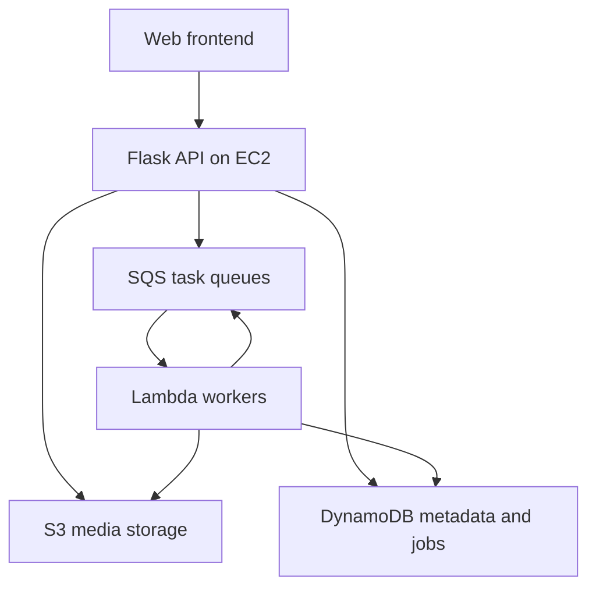

# AI Cloud Album

An event-driven photo management application built with Flask and AWS, with asynchronous image classification and ZIP processing.

[中文说明](README.zh-CN.md) · [Project report](docs/final-report.pdf) · [API specification](docs/API_design.md) · [Setup](docs/SETUP.md)

## Features

- JWT authentication and password hashing.
- Individual image uploads and asynchronous ZIP upload/download jobs.
- Image storage in S3 and metadata/job tracking in DynamoDB.
- SQS-triggered Lambda workers for image classification, EXIF location extraction, and ZIP processing.
- YOLOv8 classification through ONNX Runtime, rule-based follow-up questions, category browsing, keyword search, and Leaflet maps.

## Architecture

There are separate queues/workers for ZIP extraction, image processing, and ZIP download generation. The frontend polls the API for results. Follow-up questions use label-based rules rather than a language model.

## My contribution — Huaitang Wang

As documented in the team report, I was responsible for **backend development and AWS integration**:

- Implemented Flask REST APIs for authentication, image upload, and metadata management.
- Integrated S3, SQS, and DynamoDB and coordinated communication with Lambda workers.
- Supported asynchronous workflow design, EC2 deployment, and distributed system integration/debugging.

This is a team course project for USC EE547. Team members: **Shi He, Huaitang Wang, and Boxiang Zhang**. Boxiang Zhang led frontend/UI integration; Shi He led ML and asynchronous processing. This personal portfolio copy preserves team attribution.

## Repository guide

| Path | Contents |
| --- | --- |
| `backend/` | Flask routes/services, Dockerfile, API integration tests |
| `frontend/` | HTML/CSS/JavaScript UI and Leaflet assets |
| `lambda/class/` | Classification worker, ONNX model, label mapping |
| `lambda/upload/`, `lambda/download/` | ZIP processing workers |
| `lambda/name/`, `lambda/test/` | Earlier design / development utilities |
| `lambda/yolov8/` | Training script; dataset and PyTorch checkpoints excluded |
| `docs/` | Report, setup, API/schema notes, original training outputs |
| `data/` | Data preparation scripts and experimental coordinate data |

## Running

The complete application requires provisioned AWS resources and credentials. It is not a standalone offline demo. See [setup instructions](docs/SETUP.md) and the included `.env.example` files. No active public demo is advertised.

## Scope and limitations

- This is a course prototype; AWS provisioning/IAM policies and a reproducible Lambda dependency build are not automated here.
- The ONNX inference model is included; training data and PyTorch checkpoints are not included.
- Existing API integration tests require a configured running backend and AWS resources. They create accounts and upload files.
- Original frontend mock utilities are development examples, not the application's authentication implementation.
- Third-party code, model weights, and dataset-derived artifacts retain their original rights. This copy does not add a blanket open-source license.
